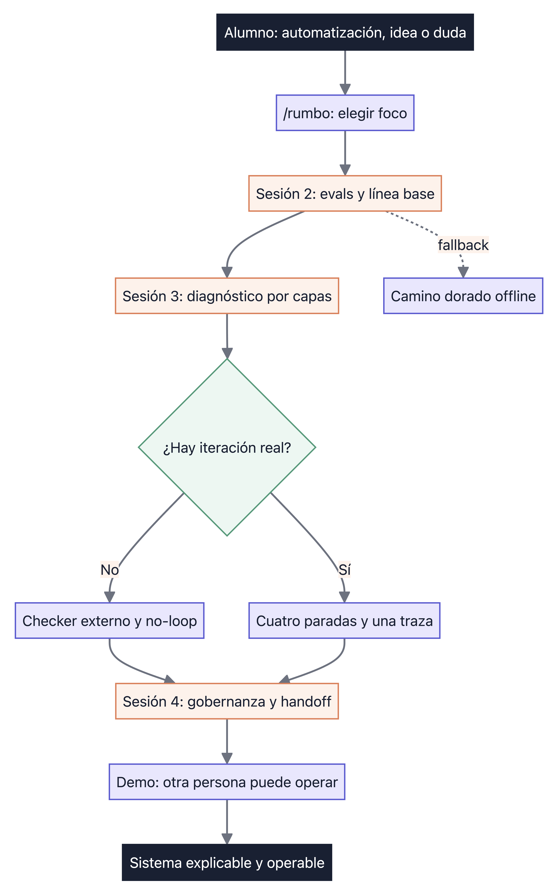

<h1 align="center">Agentic AI &amp; Automation Mentor Agent 2026</h1>

<p align="center"><strong>Curso avanzado para convertir automatizaciones en sistemas medibles, gobernables y operables por otra persona.</strong></p>

<p align="center">
  
</p>

<p align="center"><sub>Ilustración: <a href="https://www.behance.net/biosisniega">Raúl Sisniega</a> ©</sub></p>

<p align="center">
  <a href="LICENSE"></a>
  <a href="https://github.com/nabolom/agentic-ai-automation-mentor-agent-2026/actions/workflows/validate.yml"></a>
  <a href="https://www.python.org/"></a>
  <a href="https://code.claude.com/docs/en/overview"></a>
  <a href="ALUMNO-EMPIEZA-AQUI.md"></a>
  <a href="docs/competencias.md"></a>
  <a href="ejemplo/README.md"></a>
</p>

## 🚦 Sesión de trabajo — Panorama de Agent Engineering Q4-2026

**Primera sesión técnica de la cohorte · 150 minutos.** La reunión anterior fue de bienvenida y contexto. Aquí empieza el trabajo con el repositorio y el Agente Mentor.

➡️ Empieza por la guía de [`S1+S2: Panorama y primera medición`](curso/S1-S2-panorama-y-evals.md). Incluye la plenaria, la teoría, el break, el laboratorio con Claude Code y los entregables.

### Elige tu punto de entrada

| Si llegas con… | Trabajarás en… |
|---|---|
| Una idea o proceso, pero ninguna automatización | **Descubrir:** elegir un proceso acotado y una decisión |
| Un prototipo o automatización personal | **Construir:** separar `if`, IA, herramienta y humano |
| Una automatización que ya funciona, pero falla o no se mide | **Endurecer:** aislar una decisión difícil y una línea base |
| Algo que ya corre para otras personas | **Productificar / escalar:** identificar cuello de botella, riesgo, costo o handoff |

No necesitas llegar con un agente completo. El mínimo de la sesión es: **repositorio abierto o fallback documentado · una decisión de IA · tres casos ancla · salidas esperadas · siguiente paso**.

La suite de seis casos —4 típicos, 1 límite y 1 adversarial— cierra la primera medición después del laboratorio. Los diez casos son una extensión para quien termina antes.

### Si no tienes entorno listo

Abre el [`Camino dorado`](ejemplo/README.md) y trabaja offline o en papel. No necesitas una API real para aprender el contrato:

```text
if → IA → salida estructurada → validación → humano
```

La [ruta de preparación y continuidad](docs/ruta-critica-antes-de-s2.md) deja los pasos técnicos disponibles, pero ya no es la puerta principal de entrada.

## Objetivo

Este repositorio te acompaña para:

1. decidir qué automatizar y qué no, con evidencia;
2. separar lo que debe ser `if`, IA, herramienta o humano;
3. medir un sistema con casos reales y salida esperada;
4. diagnosticar si la falla está en el modelo, el contexto, el harness o la herramienta;
5. gobernar permisos, costos, aprobaciones y recuperación;
6. dejar un sistema que otra persona pueda operar sin ti.

La pregunta que guía todo el curso es:

> **Si mañana no estás, ¿alguien más puede correr el sistema, saber si funcionó y saber qué hacer si no?**

## Autoría y herramientas

**La dirección pedagógica, el diseño del curso, la doctrina y las decisiones finales de este repositorio son de León Ruiz.**

Claude Code y Cowork son **herramientas y asistentes de ejecución bajo su dirección**. No son coautores del repositorio. El criterio final, el alcance y la responsabilidad del material pertenecen a su autor y facilitador.

## Para quién es

| Perfil | Qué obtiene |
|---|---|
| Ya tienes automatizaciones y quieres productificarlas o escalarlas | Un marco para medir, endurecer, gobernar y entregar tu sistema. |
| Eres autodidacta o intermedio y ya sabes construir cosas | Una ruta que parte de tu experiencia y te pide la evidencia que falta, sin explicarte lo que ya sabes. |
| Eres avanzado | Un núcleo común y extensiones de costos, harness, MCP, loops y multiagente. |
| Todavía no tienes proyecto propio | Un camino dorado común para aprender el criterio antes de transferirlo a tu proceso. |

No es un chatbot de curso ni una lista de tutoriales. Es una infraestructura de trabajo para pasar del proceso al sistema y del sistema al producto.

## Elige tu puerta de entrada

| Soy… | Empiezo por… | Resultado inicial |
|---|---|---|
| Aprendedor(a) | [`Sesión S1+S2`](curso/S1-S2-panorama-y-evals.md) | Una decisión y tres casos ancla |
| Facilitador | [`facilitador/README.md`](facilitador/README.md) | Agenda, preguntas, rescates y extensiones |
| Aprendedor(a) avanzado(a) | [`Sesión S1+S2`](curso/S1-S2-panorama-y-evals.md) + track Productificar/escalar | Más profundidad sin repetir el onboarding |
| Sin entorno listo | [`ejemplo/README.md`](ejemplo/README.md) | Camino dorado offline o en papel |

> Si algo falla, consulta [`Dependencias y preflight`](docs/dependencias-y-preflight.md) como referencia secundaria. No instales Node/NPM si tu ruta no los necesita.

## Primeros 15 minutos de la sesión técnica

1. Crea tu copia privada con **Use this template** y clónala, o trabaja en la copia que ya tienes.
2. Abre la carpeta en Claude Code o Cowork.
3. Lee [`Empieza aquí como Aprendedor(a)`](ALUMNO-EMPIEZA-AQUI.md) para orientación ampliada.
4. Abre el [`Camino dorado`](ejemplo/README.md) si todavía no tienes proceso propio.

No necesitas leer todo el repo, conectar una API real, usar n8n ni construir un agente autónomo para empezar.

## Ruta del curso

```text
proceso → decisión → evals → diagnóstico → límites → handoff
```

| Sesión | Pregunta central | Evidencia |
|---|---|---|
| S1+S2 — Panorama Q4-2026 y primera medición | ¿Qué decisión quiero medir y cómo sabré si funciona? | Track, decisión, tres casos ancla y salidas esperadas; seis casos como continuidad |
| S3 — Loops | ¿Qué capa está fallando y necesito iteración real? | Diagnóstico, checker o cuatro paradas, traza y comparación v0 → v1 |
| S4 — Gobernanza | ¿Puede otra persona operar esto con límites claros? | Permisos, costo, aprobación, observabilidad, demo y handoff |
| S5 — Multiagente | ¿La complejidad adicional está justificada? | Extensión opcional para quien terminó el núcleo |

Los **6 casos** son el requisito mínimo válido. Los **10 casos** son una suite extendida para profundizar, no una condición para avanzar.

## Mapa del recorrido



Fuente editable: [`docs/visuales/mapa-del-curso.mmd`](docs/visuales/mapa-del-curso.mmd).

## Camino dorado

El camino dorado ofrece un caso común antes de pedirte transferir el criterio a tu automatización:

```text
entrada → if determinista → IA solo si hay ambigüedad → salida estructurada → validación → humano
```

Puedes correrlo sin credenciales:

```bash
python3 ejemplo/camino_dorado.py --modo offline --version v1
```

| Versión | Núcleo | Extendida |
|---|---:|---:|
| `v0` | 4/6 — línea base intencional | 7/10 |
| `v1` | 6/6 | 10/10 |

Si no tienes Python, abre [`ejemplo/casos.json`](ejemplo/casos.json) y recorre los seis casos en papel. El contrato y las preguntas de diseño son los mismos.

## Comandos

| Comando | Qué hace |
|---|---|
| `/rumbo` | Assessment de entrada: qué quieres construir, qué puedes demostrar y qué ruta te conviene |
| `/arrancar` | Lleva un proceso al diseño de una automatización |
| `/eval` | Corre tus evals contra el sistema y devuelve una tasa |
| `/cuatro-paradas` | Diseña y ejecuta un loop con trabajo, verificación, parada y escalamiento |
| `/auditar` | Revisión crítica: identifica riesgos, contradicciones y teatro |
| `/verificar` | Re-verifica referencias sensibles contra fuentes oficiales |

Fuera de los comandos, habla normal con el asistente de ejecución. Pídele código, discute decisiones y conserva lo importante en disco.

## Qué hay en este repositorio

```text
README.md             esta portada y las puertas de entrada
ALUMNO-EMPIEZA-AQUI.md guía de primeros 15 minutos
docs/competencias.md   mapa de competencias de salida
docs/ruta-critica-antes-de-s2.md preparación accionable para S2
docs/dependencias-y-preflight.md matriz de dependencias por ruta y sistema operativo
CLAUDE.md             instrucciones del asistente bajo tu dirección
ACOMPANAMIENTO.md     cómo cambia el acompañamiento según tu evidencia
facilitador/          checklist, guiones S2–S4, rescates y debrief
curso/                ruta de cohorte y guías de sesión
ejemplo/              camino dorado, dataset y pruebas reproducibles
proyectos/            plantillas, rúbrica, demo y handoff
patrones/             siete patrones de automatización
referencias/          hechos verificados y fechados
docs/                 instalación, doctrina, seguridad y visuales
verificar.py          validación local de pruebas, fixtures, tasas y enlaces
.github/workflows/    validación automática en cada push y pull request
```

## Cómo te acompaña el Agente Mentor

El nivel de evidencia que demuestras en `/rumbo` decide cómo se te acompaña:

| Nivel | Modo | Qué hace |
|---|---|---|
| 0–1 | Enseñar | Explica el mecanismo en corto, con un ejemplo y una sola pregunta |
| 2 | Retar | Pide la evidencia que falta: número, archivo o criterio |
| 3 | Revisar como par | Señala riesgos y contradicciones; tú conduces |

La verdad de las salidas esperadas, umbrales y límites la fija la persona que conoce la operación. El asistente propone borradores; no inventa la verdad.

## Doctrina

- **Si puedes escribirlo como un `if`, que sea un `if`.**
- **Diseña la falla, no el éxito.**
- **Salida estructurada o no hay sistema.**
- **El harness importa más que el modelo.**
- **La condición de parada debe ser verificable sin el modelo.**

La versión completa está en [`docs/doctrina.md`](docs/doctrina.md) y [`CLAUDE.md`](CLAUDE.md).

## Verificación local

Antes de clase o antes de compartir cambios, ejecuta:

```bash
PYTHONDONTWRITEBYTECODE=1 python3 verificar.py
```

La verificación cubre pruebas reproducibles, fixtures de `/rumbo`, tasas del camino dorado, enlaces locales y whitespace de Git.

## Hechos y fechas

El framing de la sesión es **Panorama de Agent Engineering Q4-2026**, con corte editorial del repositorio al 14 de octubre de 2026. Los archivos de [`referencias/`](referencias/) conservan la fecha de verificación de cada fuente: 9 de octubre de 2026 para Claude API, MCP, n8n, OKF, METR y multiagente; 13 de julio de 2026 para LangChain, harness y gobernanza.

El conocimiento se pudre. Corre `/verificar` cada dos meses o antes de tomar una decisión de costos que importe. Para hechos sensibles a fecha, usa siempre la fuente oficial.

## Créditos y licencia

[MIT](LICENSE) © 2026 León Ruiz. Curso Productividad con Claude (IA) AVANZADO, [Collective Academy](https://collectiveacademy.com/). Basado en [ai-automation-expert](https://github.com/nabolom/ai-automation-expert) (Q3 2026).

Ilustración de portada: [Raúl Sisniega](https://www.behance.net/biosisniega) ©. Publicada con autorización del autor.
